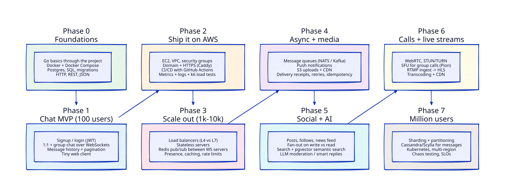
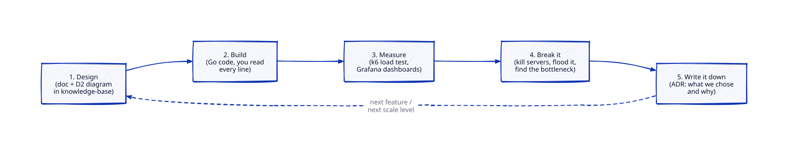
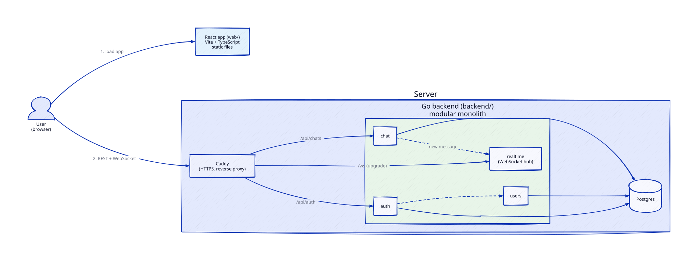
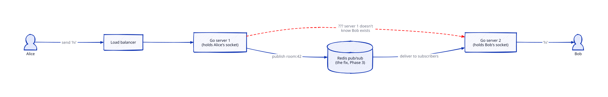
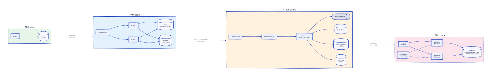

# Roadmap: Learning System Design by Building a Chat App

**Goal:** build a chat + social app in Go, deploy it on AWS, and grow it from 100 users
toward 1M — learning each system design concept at the moment the app needs it
(and sometimes before, just to understand it).



---

## Ground rules

1. **Separate frontend, modular monolith backend.** React app (`web/`) and Go backend
   (`backend/`) are independent apps. The backend starts as one binary with strict
   internal modules, and services split out from **Phase 3** onward, one at a time,
   each with a measured reason — see [monolith → microservices](concepts/monolith-to-microservices.md).
2. **Every feature goes through the loop** below. No exceptions.
3. **$0 budget.** Local Docker for nearly everything, AWS only inside the free tier,
   with free fallbacks for when it runs out — see [the cost plan](#cost-plan-0).
4. **You read every line.** I'll explain *why* in the docs; you own the code.
5. **Local git only for now.** One monorepo; GitHub (and CI) comes later.

What the app can do at each version: [01-app-versions.md](01-app-versions.md).

**Each phase is split into 3–4 parts**, and every part gets its own design doc, plan and
learnings write-up. Breakdown and progress: [phases/README.md](phases/README.md).



---

## Phases

### Phase 0 — Foundations (≈1 week)
Learn Go *through* the project, not before it.
- Repo layout, Go modules, `net/http`, `encoding/json`, error handling, goroutines, channels
- Docker + Docker Compose (Postgres runs in a container)
- SQL schema design, migrations (`golang-migrate`), indexes
- **Concepts:** client-server, HTTP methods, status codes, what a DB index really is

### Phase 1 — Chat MVP for 100 users

- Signup / login with password hashing (bcrypt) and JWT
- Create rooms (1:1 and group), send/receive messages live over **WebSockets**
- Message history with **cursor pagination** (not `OFFSET` — we'll learn why)
- React + TypeScript web app: chat list, chat view, groups, profile
- **Concepts:** HTTP vs WebSocket vs polling, stateful connections, auth, data modeling,
  back-of-envelope estimation (how many msgs/sec do 100 users actually generate?)

### Phase 2 — Ship it on AWS
- EC2, VPC, subnets, security groups, Elastic IP, IAM — the basics, by hand first
- Domain + HTTPS (Caddy auto-TLS), then Infrastructure-as-Code (Terraform) once you've clicked through it once
- One-command deploy from your laptop (`make deploy`); CI/CD with GitHub Actions once GitHub joins
- Observability: structured logs, Prometheus metrics, Grafana dashboards
- **First stress test with k6**: how many concurrent WebSockets can one t3.micro hold? Where does it fall over — CPU, memory, file descriptors, DB connections?
- **Concepts:** latency vs throughput, p50/p95/p99, connection pooling, the "it works on my machine" gap

### Phase 3 — Scale out (1k–10k users) ← *load balancers live here*

- Run 2+ app servers behind a **load balancer** (Nginx/HAProxy first, then AWS ALB briefly)
- Discover the WebSocket problem above, fix it with **Redis pub/sub**
- Presence (online/offline/typing), caching, rate limiting
- **Concepts:** L4 vs L7 LB, round-robin vs least-connections, sticky sessions, health checks,
  stateless vs stateful services, horizontal vs vertical scaling, read replicas

### Phase 4 — Async work + media
- Message queue (NATS or Kafka/Redpanda) — decouple "save message" from "notify people"
- Push notifications, offline delivery, delivered/read receipts
- Image/file upload to S3 via presigned URLs, served through CloudFront CDN
- **Concepts:** at-least-once vs exactly-once, idempotency keys, retries + backoff, dead-letter queues, message ordering

### Phase 5 — Social features + AI
- Posts, follows, likes, comments, **news feed**
- Search (Postgres full-text → OpenSearch) and **semantic search with pgvector**
- LLM-powered moderation, smart replies, chat summaries — the AI-role angle
- **Concepts:** fan-out on write vs fan-out on read (the celebrity problem), denormalization, counters at scale, embeddings, RAG

### Phase 6 — Group calls + live streams
- 1:1 calls with **WebRTC** (signaling over our WebSocket server, STUN/TURN)
- Group calls with an **SFU** (Pion, written in Go)
- Live streaming: RTMP ingest → transcode (ffmpeg) → HLS → CDN
- **Concepts:** UDP vs TCP, NAT traversal, mesh vs SFU vs MCU, adaptive bitrate

### Phase 7 — Toward a million users
- Database sharding & partitioning; move messages to Cassandra/ScyllaDB
- Split the monolith where measurements say so; Kubernetes + autoscaling
- Multi-region, geo-DNS, disaster recovery
- Chaos testing, SLOs/error budgets, on-call runbooks
- **Concepts:** CAP/PACELC, consistent hashing, replication strategies, consensus (Raft), backpressure



---

## Cost plan: $0

The rule: **anything that can be learned locally is learned locally.** AWS is used only
for things that need the real internet or real AWS, and only within the free tier.

### 1. Local lab (free, forever) — where ~80% of the learning happens

| Real-world thing | Free local stand-in |
|---|---|
| Multiple servers + load balancer | Docker Compose: N backend containers behind Nginx / HAProxy |
| AWS S3 | MinIO (same S3 API, so our code doesn't change) |
| Redis, Kafka/NATS, Postgres replicas | Their official Docker images |
| Kubernetes (Phase 7) | kind or k3d (Kubernetes running inside Docker) |
| Network failures, slow links | Toxiproxy, `tc` — inject latency and packet loss |
| Monitoring | Prometheus + Grafana + Loki in Docker |
| Load generation | k6 (free, open source) |

Limit: one laptop can't produce truly huge load. That's fine — we learn to find the
bottleneck at whatever scale we can reach, which is the actual skill.

### 2. AWS — only inside the free tier

**Which free tier you have depends on when the account was created:**
- **After 15 July 2025 → "Free plan":** up to $200 in credits, valid for 6 months. On this
  plan AWS **won't charge your card** — when the credits or the 6 months run out, the
  account is suspended unless you choose to upgrade. Safest option for a $0 budget.
- **Before that → legacy 12-month free tier:** 750 h/month of t2/t3.micro, 750 h of public
  IPv4, RDS micro, 5 GB S3. Anything outside it **is charged**, so the guard-rails below matter.

**Guard-rails (set up before launching anything):**
- AWS Budget with an alert at **$0.01** (a "zero-spend budget")
- MFA on root user; work as an IAM user
- Everything created with Terraform → `terraform destroy` after each lab session
- Never create: NAT Gateway, idle Elastic IPs, load balancers left running overnight, anything outside free-tier sizes
- Load balancer labs (AWS ALB) are short sessions: create, test, destroy the same day

### 3. After the AWS free tier ends — still $0

| Need | Free option |
|---|---|
| Always-on server for real users | Oracle Cloud "Always Free" (Arm VM, up to 4 cores / 24 GB RAM) |
| Hosting the React app | Cloudflare Pages (static hosting + CDN) |
| Exposing your laptop to the internet | Cloudflare Tunnel |
| Domain + HTTPS | Free subdomain (e.g. `*.pages.dev`, DuckDNS); a real domain is the one optional ~$10/yr cost |
| Transactional email (password reset) | Resend / Brevo free tier |

Free-tier terms change — we re-check each provider's current limits when we get to it.

---

## Repo layout (monorepo)

```
system/
├── knowledge-base/        # docs, diagrams, decisions
│   ├── diagrams/          # .d2 sources + rendered .svg
│   ├── concepts/          # one note per concept
│   └── adr/               # Architecture Decision Records
├── backend/               # Go module (cmd/ per binary, internal/ per module)
├── web/                   # React + TypeScript (Vite)
├── deploy/                # docker compose, terraform, Caddy/Nginx config
└── loadtest/              # k6 scripts
```

When services split out (Phase 3+), each gets its own `backend/cmd/<service>` binary;
moving to separate repos later is just copying a folder.

## Next steps

Work through the parts in [phases/README.md](phases/README.md) in order, starting with **0.1 Dev environment**.
One git branch per part.
