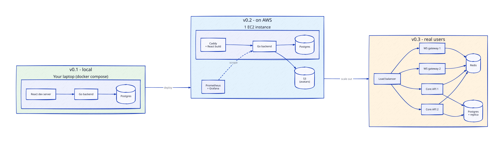

# App Versions: What the App Can Do After Each Phase

This is the **product** view: what a user can actually do at each version.
The system design learning happens underneath, but every version is a real, usable app.

The name is a placeholder until we pick one: **Relay**.

---

## Fixed from day 1

- **Frontend:** React + TypeScript (Vite), TanStack Query for server data, Tailwind for styling.
  Its own app in `web/`, talking to the backend only over HTTP + WebSocket.
- **Backend:** Go in `backend/`, a **modular monolith** — one binary, but split into internal
  modules (`auth`, `users`, `chat`, `realtime`) that only talk through Go interfaces.
  This is what makes the later move to microservices a mechanical step, not a rewrite.
  See [monolith → microservices](concepts/monolith-to-microservices.md).
- **Database:** Postgres. Migrations from the start.
- **Everything runs with one command:** `docker compose up`.
- **Tests:** Go unit + integration tests (against a real Postgres in Docker), Playwright for a few key UI flows.

---

## v0.1 — "It works on my machine" (end of Phase 1)

*You and a couple of friends on your local network can chat in real time.*

**Accounts**
- Sign up with email + password, log in, log out
- Sessions with short-lived access token + refresh token (httpOnly cookie)
- Profile: display name, username, bio

**Chats**
- Search users by username, start a 1:1 chat
- Create a group (name, members), add/remove members, group admin role
- Chat list sidebar: last message preview, time, **unread count**, sorted by latest activity
- Send text messages — appear instantly for everyone in the chat (WebSocket)
- Edit and delete your own messages (everyone sees the change live)
- Scroll up for history (infinite scroll, cursor pagination)
- Reconnect automatically after Wi-Fi drops, and fetch what you missed

**Done when**
- 2 browsers, 2 users: messages arrive in < 200 ms locally
- A k6 script simulating **100 concurrent users** sending messages passes with no errors
- Design doc + ADRs for: auth approach, schema, WebSocket protocol

---

## v0.2 — "Live on the internet" (end of Phase 2)

*Friends anywhere can use it via a real HTTPS URL. You can see how it's doing.*

**New for users**
- Typing indicators ("Alice is typing…")
- Read receipts (✓ sent, ✓✓ seen) in 1:1 chats, "seen by N" in groups
- Message reactions (emoji)
- Reply to a specific message (quoted reply)
- Profile picture upload (stored in S3, or MinIO locally)
- Browser notifications + unread badge in the tab title when the tab is in the background
- Dark mode

**New under the hood**
- Deployed on AWS: React build served as static files, Go API + Postgres on EC2
- HTTPS, environment config, secrets kept out of the repo
- One-command deploy (`make deploy`) — CI/CD comes when GitHub enters the picture
- Grafana dashboard: active connections, messages/sec, p95 latency, errors, DB pool usage
- Structured logs you can search
- Load test against the real server: **we find the exact number of users one micro instance can handle**, and write down what broke first

**Done when**
- 100 simulated users on the AWS server for 30 min, p95 delivery < 300 ms
- We know the breaking point and the bottleneck, written up in `concepts/`
- Rebuilding the whole setup from scratch takes one command (Terraform)

---

## v0.3 — "Ready for real users" (end of Phase 3)

*Good enough to invite strangers. Survives a server dying.*

**New for users**
- Online / last seen status
- Multiple tabs and devices for the same account stay in sync
- "Log out of all other devices"
- Forgot password / reset via email, email verification
- Group invite links
- Search messages inside a chat
- Block a user, report a message
- Image messages (upload, thumbnail, view full size)

**New under the hood**
- 2+ backend servers behind a load balancer; kill one, chats keep working (clients reconnect)
- Redis: pub/sub between servers, presence, rate limiting, caching hot data
- **First service split:** the WebSocket gateway becomes its own service (see the microservices note)
- Rate limiting and basic spam protection (per user, per IP)
- Postgres read replica for history reads
- Backups + a tested restore
- Zero-downtime deploys (rolling restart behind the load balancer)

**Done when**
- 1,000+ simulated concurrent users across 2+ servers locally, and as many as the free AWS setup allows
- Chaos test: kill a server, kill Redis, restart Postgres — app recovers, no messages lost
- Privacy policy + terms page (needed before real users)

---

## Later versions (rough)

| Version | Phase | What users get |
|---|---|---|
| v0.4 | 4 | File/voice-note sharing, push notifications when offline, delivery guarantees, message queue underneath |
| v0.5 | 5 | Posts, follows, feed, likes/comments, global search, AI: smart replies, chat summaries, moderation |
| v0.6 | 6 | 1:1 and group voice/video calls, screen share, live streams with chat |
| v1.0 | 7 | Built to scale to millions: sharded storage, multi-region, Kubernetes |
