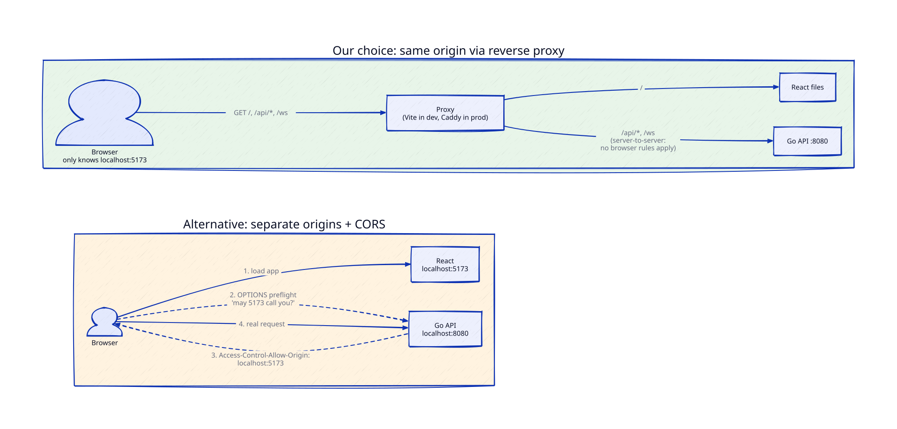
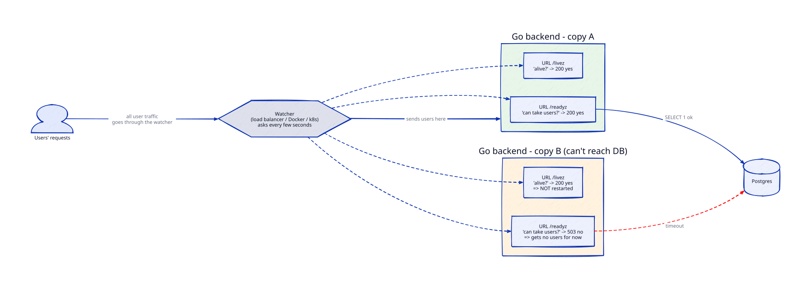
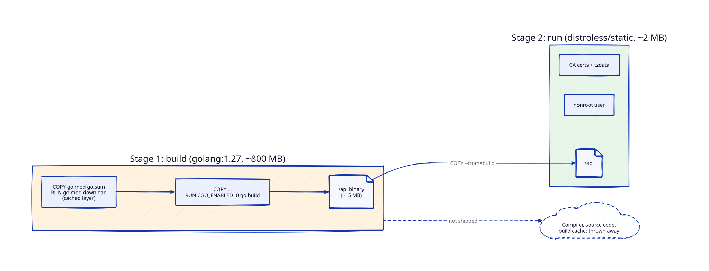

# Notes — Concepts to Revisit

Important concepts that come up while we design and build. Each note is short enough to
re-read in 5 minutes, with pointers for going deeper in your free time.

Format per note: **What it is → Why it matters → What we chose → In our code → Gotchas → Go deeper → Interview angle.**

## Index

| # | Concept | Came up in |
|---|---|---|
| 1 | [Same-origin policy, CORS & reverse proxies](#1-same-origin-policy-cors--reverse-proxies) | Part 0.1, decision C |
| 2 | [Health checks: liveness vs readiness](#2-health-checks-liveness-vs-readiness) | Part 0.1, decision D |
| 3 | [Multi-stage Docker builds & base images](#3-multi-stage-docker-builds--base-images) | Part 0.1, decision E |

---

## 1. Same-origin policy, CORS & reverse proxies

*Came up in Part 0.1 — how the React app reaches the Go API.*



### What it is

**Origin** = scheme + host + port. All three must match for two URLs to be the same origin:

| URL A | URL B | Same origin? |
|---|---|---|
| `http://localhost:5173` | `http://localhost:8080` | ❌ port differs |
| `https://relay.com` | `http://relay.com` | ❌ scheme differs |
| `https://app.relay.com` | `https://api.relay.com` | ❌ host differs |
| `https://relay.com/a` | `https://relay.com/b` | ✅ path doesn't matter |

**Same-origin policy (SOP):** the browser's core security rule. JavaScript on one origin
can't *read* responses from another origin. Without it, any website you visit could
call `fetch("https://yourbank.com/account")` — with your bank cookies attached — and read your data.

Subtle point: SOP mostly blocks **reading the response**, not **sending the request**.
A simple cross-origin POST still reaches the server; JS just can't see the reply.
That's why CSRF attacks exist (Part 1.1).

**CORS (Cross-Origin Resource Sharing):** the server's way of saying "I allow these
other origins to read my responses", using response headers:

```
Access-Control-Allow-Origin: https://app.relay.com
Access-Control-Allow-Credentials: true        # allow cookies
Access-Control-Allow-Methods: GET, POST, PATCH, DELETE
Access-Control-Allow-Headers: Content-Type, Authorization
Access-Control-Max-Age: 600                   # cache the preflight for 10 min
```

**Preflight:** for "non-simple" requests (JSON body, `Authorization` header, `PATCH`/`DELETE`…)
the browser first sends an `OPTIONS` request asking permission, and only sends the real
request if the answer is yes. That's an extra round trip (unless cached via `Max-Age`).

**Reverse proxy:** a server that sits in front of your app servers and forwards requests
to them. The client only sees the proxy. (A *forward* proxy is the opposite: it sits in
front of *clients*, like a corporate proxy.) Reverse proxies also do TLS, compression,
caching, load balancing — Nginx, Caddy, HAProxy, Envoy, AWS ALB are all reverse proxies.

### Why it matters for us

- The proxy makes React and the API **one origin**, so SOP never gets in the way —
  the proxy → Go hop is server-to-server, and browser rules don't apply there.
- Cookies stay simple: our refresh-token cookie (Part 1.1) is first-party.
- The same proxy will later become our **load balancer** (Phase 3) — one concept, growing.

### What we chose

**Same origin via reverse proxy** (Part 0.1, decision C):

| Mode | Proxy | Routes |
|---|---|---|
| dev | Vite dev server | `/` → React (hot reload), `/api/*` + `/ws` → `localhost:8080` |
| full / prod | Caddy container | `/` → built React files, `/api/*` + `/ws` → `api:8080` |

WebSockets need the proxy to pass through the HTTP `Upgrade` handshake — Vite needs
`ws: true` in its proxy config; Caddy does it automatically.

### In our code

| Code | What it does |
|---|---|
| [`web/vite.config.ts:12`](../web/vite.config.ts#L12) | **Dev proxy.** Vite forwards `/api/*` to Go on `localhost:8080` |
| [`web/Caddyfile:7`](../web/Caddyfile#L7) | **Full-mode proxy.** Caddy forwards `/api/*` to the `api` container |
| [`web/Caddyfile:13`](../web/Caddyfile#L13) | Everything else gets the React files (that's why `/livez` isn't exposed) |
| [`web/src/status/api.ts:17`](../web/src/status/api.ts#L17) | React calls `fetch('/api/status')` — a **relative** path, so it goes to whichever proxy served the page |

[`web/vite.config.ts:12`](../web/vite.config.ts#L12)

```ts
// web/vite.config.ts — dev mode
proxy: {
  '/api': 'http://localhost:8080',   // "/api…" → Go on your machine
},
```

[`web/Caddyfile:7`](../web/Caddyfile#L7)

```
# web/Caddyfile — full mode
handle /api/* {
    reverse_proxy api:8080           # "/api/…" → the Go container (by its compose service name)
}
```

[`web/src/status/api.ts:17`](../web/src/status/api.ts#L17)

```ts
// web/src/status/api.ts — the React side
fetch('/api/status', ...)            // no host → same origin as the page
```

**See it yourself:** `make dev` → open the page → DevTools (F12) → Network → click
`status`. The request URL is `localhost:5174/api/status` — the browser never talks to `:8080`.

### Gotchas

- **CORS is not server security.** It only restrains browsers. `curl` or a script ignores
  it completely, so never rely on CORS to protect an API — that's what auth is for.
- `Access-Control-Allow-Origin: *` **cannot** be combined with credentials (cookies).
  You must echo a specific allowed origin.
- **Same-site ≠ same-origin.** `app.relay.com` and `api.relay.com` are *cross-origin* but
  *same-site* (same registrable domain `relay.com`), so `SameSite=Lax` cookies still flow
  between them. Truly different sites (`relay.com` ↔ `relay-api.io`) need `SameSite=None; Secure`.
- A proxy hides the real client IP — the app must read `X-Forwarded-For` (and only trust
  it from the proxy). Matters for rate limiting in Phase 3.

### Go deeper

- MDN: *Same-origin policy* and *Cross-Origin Resource Sharing (CORS)* — the definitive reference
- Open DevTools → Network on any big site, find an `OPTIONS` request, read its headers
- Try it in Part 0.1: temporarily call `http://localhost:8080/api/health` directly from
  React, watch the CORS error in the console, then see the proxy fix it
- web.dev: *SameSite cookies explained*

### Interview angle

- "Why does my fetch work in Postman but fail in the browser?" → SOP/CORS, Postman isn't a browser.
- "What does a reverse proxy / API gateway do in your architecture?" → TLS termination,
  routing, load balancing, rate limiting, hiding internal services.
- "How would you serve web + mobile clients?" → mobile apps aren't bound by SOP; a public
  API for third parties would need CORS (or a separate API domain).

---

## 2. Health checks: liveness vs readiness

*Came up in Part 0.1 — what `/health` should check.*



**Reading the diagram:** "copy A" and "copy B" are two identical copies of the **Go backend
only** — the frontend isn't here (it's static files served separately by Caddy/a CDN). The
two boxes inside each copy are two **URLs** on that backend, not two programs. The
**watcher** calls them; users never do.

### What it is

Something outside your app (a load balancer, Kubernetes, Docker, AWS) regularly calls
an endpoint to ask "are you OK?" — and **acts on the answer**. There are two different
questions, and they lead to two different actions:

| Probe | Question | If it fails… | Should check dependencies? |
|---|---|---|---|
| **Liveness** `/livez` | Is the process alive and not stuck? | **Restart** the server | ❌ Never |
| **Readiness** `/readyz` | Can it serve requests *right now*? | **Stop sending traffic** to it (no restart) | ✅ Yes — DB, etc. |
| *Startup* `/startupz` | Has it finished booting? | Wait; don't run the other probes yet | — |

### Why readiness checks Postgres (and liveness doesn't)

**Postgres is our database** — a separate program (in Docker) where all the app's data
lives permanently: users, chats, messages. The Go backend holds no data itself; it asks
Postgres for everything.

```
browser ──► Go backend ──► Postgres
            (logic)        (data lives here)
```

- Almost every user request needs the database. If the backend can't reach Postgres,
  it's *running* but *useless* → the honest answer to "can you take users?" is **no** →
  `/readyz` checks Postgres.
- Restarting the backend doesn't fix a broken database → `/livez` ignores Postgres.

**How we check:** a **ping** (≈ `SELECT 1`, "are you there?") with a **1-second limit**.
- Tiny on purpose: the watcher calls it every few seconds on every copy — a real query
  would load the DB just to check on it.
- The time limit matters: without it, a frozen Postgres makes the ping — and the health
  check — wait forever. With it, we always get an answer fast, even if it's "down".
- The measured time is the **latency** on the status page (`healthy (2 ms)`). If it
  climbs under load, the DB is struggling — an early warning we'll graph in Phase 2.

### Why it matters

**The classic outage:** a single `/health` that checks the database. Postgres has a
5-second blip → *every* server fails its health check at once → the orchestrator
restarts all of them (or the LB removes all of them) → a tiny DB hiccup becomes a full
outage, and the restart storm hammers the DB as it recovers.

Split probes avoid that: during the blip, servers stay alive (liveness OK), just stop
taking traffic (readiness fails), and come back on their own when the DB returns.

### What we chose

**Two endpoints** (Part 0.1, decision D):
- `/livez` → always `200 {"status":"alive"}` if the HTTP server can respond at all
- `/readyz` → pings Postgres with a short timeout (e.g. 1s);
  `200 {"status":"ready","checks":{"postgres":{"status":"ok","latency_ms":2}}}` or `503` with details
- React's status page calls `/readyz` through the proxy
- Docker Compose `healthcheck:` uses them in full mode; Phase 3's load balancer and
  Phase 7's Kubernetes will too
- `/startupz` gets added when slow startup work appears (migrations on boot)

### In our code

| Code | What it does |
|---|---|
| [`backend/internal/health/checker.go:41`](../backend/internal/health/checker.go#L41) | `CheckPostgres` — pings the DB with a **1 s timeout** (`context.WithTimeout`, next line) |
| [`backend/internal/health/handler.go:33`](../backend/internal/health/handler.go#L33) | `Register` — which URL goes to which function |
| [`backend/internal/health/handler.go:41`](../backend/internal/health/handler.go#L41) | `livez` — checks nothing |
| [`backend/internal/health/handler.go:46`](../backend/internal/health/handler.go#L46) | `readyz` — 200 or 503 from the DB check |
| [`backend/internal/health/handler.go:55`](../backend/internal/health/handler.go#L55) | `status` — details for the UI |
| [`backend/internal/health/checker_test.go:47`](../backend/internal/health/checker_test.go#L47) | `TestCheckPostgres_PingHangs_GivesUpAtTimeout` — proves the 1-second limit works |
| [`backend/internal/health/handler_test.go:41`](../backend/internal/health/handler_test.go#L41) | `TestLivez_DBDown_StillReturns200` — this note's main rule, as a test |
| [`backend/cmd/api/main.go:93`](../backend/cmd/api/main.go#L93) | `healthcheck()` — the binary checks its own `/livez` (no curl in distroless)… |
| [`backend/internal/health/probe.go:13`](../backend/internal/health/probe.go#L13) | …using `Probe` |
| [`compose.yaml:16`](../compose.yaml#L16) | Postgres healthcheck (`pg_isready`) |
| [`compose.yaml:34`](../compose.yaml#L34) | API healthcheck (`/api healthcheck`) |

[`backend/internal/health/handler.go:41`](../backend/internal/health/handler.go#L41)

```go
// handler.go — liveness deliberately checks nothing
func (h *Handler) livez(w http.ResponseWriter, r *http.Request) {
	writeJSON(w, http.StatusOK, map[string]string{"status": "alive"})
}

// readiness checks the database
func (h *Handler) readyz(w http.ResponseWriter, r *http.Request) {
	if h.checker.CheckPostgres(r.Context()).Status != StatusOK {
		writeJSON(w, http.StatusServiceUnavailable, map[string]string{"status": "not_ready"})
		return
	}
	writeJSON(w, http.StatusOK, map[string]string{"status": "ready"})
}
```

**See it yourself:** `make dev`, then `docker compose stop postgres` and run
`curl -i localhost:8080/livez` (200) vs `curl -i localhost:8080/readyz` (503).

### Gotchas

- **Probes must be cheap and fast** — they run every few seconds on every server. `SELECT 1`, not a real query.
- **Always use a timeout** inside the check. A hanging DB call makes the probe hang,
  and the prober's own timeout produces confusing failures.
- **Don't check *other services* in readiness** unless you truly can't work without them —
  otherwise one failing service cascades into marking everything unready.
- **Graceful shutdown uses readiness:** on shutdown, first fail `/readyz` so the LB stops
  sending new requests, *then* finish in-flight requests, *then* exit. We'll do this in 0.2.
- Health endpoints can leak internals (versions, hostnames) — keep details minimal on public routes.

### Go deeper

- Kubernetes docs: *Configure Liveness, Readiness and Startup Probes*
- AWS docs: *Health checks for your target groups* (ALB) — same idea, different names
- Google SRE book, chapter *Addressing Cascading Failures* (free online)

### Interview angle

- "How does your load balancer know a server is down?" → health checks, interval,
  healthy/unhealthy thresholds, liveness vs readiness.
- "What happens to in-flight requests when you deploy?" → readiness + graceful shutdown + connection draining.
- "How do you stop one failing dependency from taking everything down?" → don't put it in liveness; circuit breakers (Phase 3+).

---

## 3. Multi-stage Docker builds & base images

*Came up in Part 0.1 — which image the Go binary runs in.*



### Docker basics first

```
  Dockerfile ──(docker build)──► Image ──(docker run / compose)──► Container
  a recipe                       a frozen box                      the box, running
```

- **Container** — a program running in its own sealed box, with everything it needs
  already installed inside. That's why you don't install packages yourself.
- **Image** — the frozen snapshot a container starts from. Image : container =
  class : object. One image can start many containers.
- **Where images come from:** *downloaded* ready-made (`image: postgres:18` in
  [`compose.yaml:7`](../compose.yaml#L7)) or *built* by us from a Dockerfile
  (`build: ./backend` in [`compose.yaml:24`](../compose.yaml#L24)) — nobody publishes an image of *our* app.
- **Dockerfile** — the recipe: start from X, copy code in, build it, run it.
  **`docker build`** follows the recipe and produces an image (`make up-full` does this for you).
- **Base image** — the `FROM` line: the existing image the recipe starts from, like
  starting from a project template instead of an empty folder.
- **Multi-stage** — two `FROM`s in one recipe. Stage 1 is the **kitchen** (big image
  with compilers, ~800 MB) where the app is built; stage 2 is the **lunchbox** (tiny
  image) that gets *only the finished program*. The kitchen is thrown away.

```
STAGE 1 "build" (kitchen)                STAGE 2 final (lunchbox)
FROM golang:1.27  (~800 MB)              FROM distroless (~2 MB)
copy code, go build → /api (15 MB) ────► COPY --from=build /api
kitchen thrown away ✗                    ships: ~20 MB total
```

- **Dev vs full mode:** in `make dev` only Postgres runs in Docker (Go and React run
  on your machine for instant reloads). In `make up-full` all three run in containers.

### What it is (in more depth)

**Image vs container:** an *image* is a read-only template (filesystem + startup command);
a *container* is a running instance of it. One image → many containers.

**Layers:** every Dockerfile instruction (`COPY`, `RUN`…) creates a layer. Docker caches
layers and reuses them if nothing they depend on changed. Order matters: put things that
rarely change (dependencies) *before* things that change often (your code).

**Multi-stage build:** one Dockerfile, several `FROM` stages. Early stages have heavy
tools (compiler); the final stage copies in only the result. Everything else is thrown away.

```dockerfile
# ---- stage 1: build ----
FROM golang:1.27 AS build
WORKDIR /src
COPY go.mod go.sum ./
RUN go mod download                 # cached until go.mod/go.sum change
COPY . .
RUN CGO_ENABLED=0 go build -o /api ./cmd/api

# ---- stage 2: run ----
FROM gcr.io/distroless/static:nonroot
COPY --from=build /api /api
USER nonroot
ENTRYPOINT ["/api"]
```

**Base image options for the final stage:**

| Image | Size | Contains | Shell |
|---|---|---|---|
| `scratch` | 0 MB | nothing | ❌ |
| `distroless/static` | ~2 MB | CA certs, tzdata, `/etc/passwd` with nonroot user | ❌ |
| `alpine` | ~8 MB | musl libc, busybox shell, `apk` package manager | ✅ |
| `debian-slim` | ~75 MB | full glibc userland | ✅ |

### Why it matters

- **Smaller image** → faster pulls on deploy and autoscaling (Phase 3/7), less disk, cheaper.
- **Smaller attack surface** → no shell or package manager for an attacker to use; fewer CVEs in scanners.
- **Reproducible builds** → the same Dockerfile builds the same thing on your laptop and on AWS.

### What we chose

**`gcr.io/distroless/static:nonroot`** (Part 0.1, decision E). Go compiles to one
static binary when `CGO_ENABLED=0`, so it needs nothing from the OS except CA
certificates (to verify HTTPS servers like S3) and timezone data — exactly what distroless/static gives.

### In our code

| Code | What it does |
|---|---|
| [`backend/Dockerfile:4`](../backend/Dockerfile#L4) | Go **build** stage: `golang:1.27` |
| [`backend/Dockerfile:18`](../backend/Dockerfile#L18) | Go **run** stage: `distroless/static:nonroot`, and the next line copies in only the binary |
| [`backend/.dockerignore:1`](../backend/.dockerignore#L1) | Keeps `tmp/`, `.env` out of the build |
| [`web/Dockerfile:4`](../web/Dockerfile#L4) | React **build** stage: `node:24-alpine` |
| [`web/Dockerfile:16`](../web/Dockerfile#L16) | React **run** stage: `caddy:2-alpine` serves the built files |
| [`compose.yaml:24`](../compose.yaml#L24) | `build:` for `api`; passes the git commit as `VERSION` (line 27) |
| [`compose.yaml:44`](../compose.yaml#L44) | `build:` for `web` |

Result: `relay-api` image = **20 MB** (vs ~800 MB for the `golang` build image).

**See it yourself:** `make up-full`, then `docker images | grep relay` and
`docker history relay-api`.

### Gotchas

- **`CGO_ENABLED=0`** makes the binary fully static. Without it, Go may link to the
  system C library (glibc), and the binary crashes on images that don't have it
  (scratch, distroless/static, alpine's musl) with a confusing "not found" error.
- **`scratch` + HTTPS = `x509: certificate signed by unknown authority`** — no CA certs.
- **Layer cache busting:** `COPY . .` before `go mod download` re-downloads all
  dependencies on every code change. Copy `go.mod`/`go.sum` first.
- **`.dockerignore`** — without it, `COPY . .` sends `node_modules`, `.git`, `.env`
  (secrets!) into the build. Always add one.
- **Never run as root** in the container: if the app is compromised, root in the
  container is one kernel bug away from root on the host.
- **No shell = debug differently:** logs, metrics, or `docker debug <container>` /
  ephemeral debug containers that attach tools from outside.

### Go deeper

- Docker docs: *Multi-stage builds* and *Build cache*
- `docker history <image>` — see every layer and its size
- `dive` (open-source tool) — explore an image layer by layer
- GoogleContainerTools/distroless on GitHub — README explains each variant
- Scan an image for CVEs: `docker scout cves <image>` or `trivy image <image>`

### Interview angle

- "How do you keep container images small and secure?" → multi-stage, minimal base, non-root, `.dockerignore`, scanning.
- "Why are your deploys slow?" → huge images, bad layer ordering, no build cache.
- "Container vs VM?" → containers share the host kernel (namespaces + cgroups); VMs have their own kernel.
