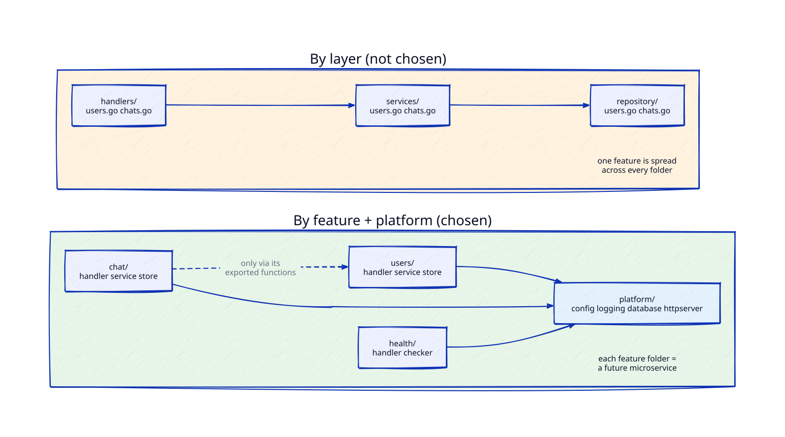
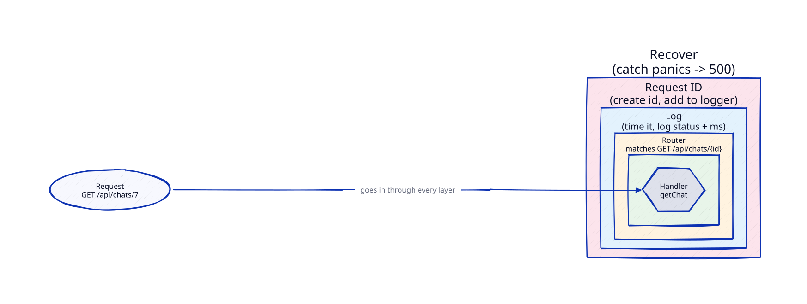
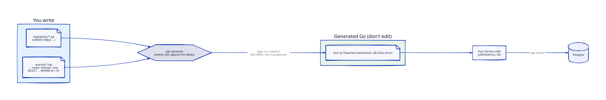
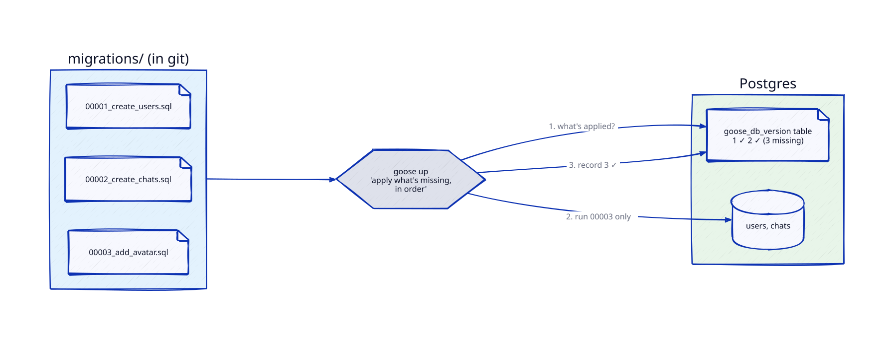
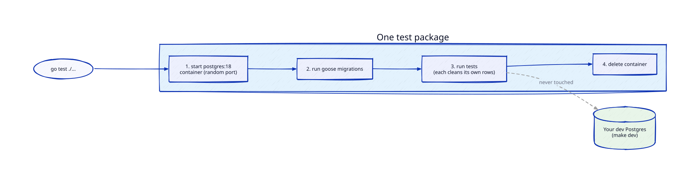
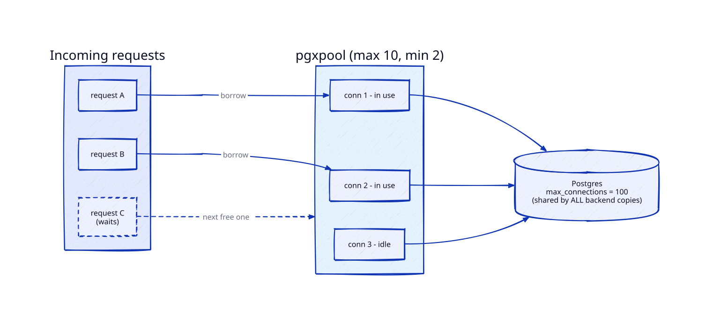

# Notes — Concepts to Revisit

Important concepts that come up while we design and build. Each note is short enough to
re-read in 5 minutes, with pointers for going deeper in your free time.

Format per note: **What it is → Why it matters → What we chose → In our code → Gotchas → Go deeper → Interview angle.**

## Index

| # | Concept | Came up in |
|---|---|---|
| 1 | [Same-origin policy, CORS & reverse proxies](#1-same-origin-policy-cors--reverse-proxies) | Part 0.1, decision C |
| 2 | [Health checks: liveness vs readiness](#2-health-checks-liveness-vs-readiness) | Part 0.1, decision D |
| 3 | [Multi-stage Docker builds & base images](#3-multi-stage-docker-builds--base-images) | Part 0.1, decision E |
| 4 | [Go packages & project layout](#4-go-packages--project-layout) | Part 0.2, decision B |
| 5 | [Configuration via environment variables](#5-configuration-via-environment-variables) | Part 0.2, decision C |
| 6 | [Structured logging & request IDs](#6-structured-logging--request-ids) | Part 0.2, decision D |
| 7 | [HTTP routing & middleware](#7-http-routing--middleware) | Part 0.2, decision E |
| 8 | [Talking to the database: driver, ORM or sqlc](#8-talking-to-the-database-driver-orm-or-sqlc) | Part 0.2, decision F |
| 9 | [Database migrations](#9-database-migrations) | Part 0.2, decisions G–H |
| 10 | [Unit vs integration tests (Testcontainers)](#10-unit-vs-integration-tests-testcontainers) | Part 0.2, decision I |
| 11 | [Database connection pooling](#11-database-connection-pooling) | Part 0.2, decision J |

---

## 1. Same-origin policy, CORS & reverse proxies

*Came up in Part 0.1 — how the React app reaches the Go API.*


### What it is

**Origin** = scheme + host + port. All three must match for two URLs to be the same origin:

| URL A | URL B | Same origin? |
|---|---|---|
| `http://localhost:5173` | `http://localhost:8080` | ❌ port differs |
| `https://relay.com` | `http://relay.com` | ❌ scheme differs |
| `https://app.relay.com` | `https://api.relay.com` | ❌ host differs |
| `https://relay.com/a` | `https://relay.com/b` | ✅ path doesn't matter |

**Same-origin policy (SOP):** the browser's core security rule. JavaScript on one origin
can't *read* responses from another origin. Without it, any website you visit could
call `fetch("https://yourbank.com/account")` — with your bank cookies attached — and read your data.

Subtle point: SOP mostly blocks **reading the response**, not **sending the request**.
A simple cross-origin POST still reaches the server; JS just can't see the reply.
That's why CSRF attacks exist (Part 1.1).

**CORS (Cross-Origin Resource Sharing):** the server's way of saying "I allow these
other origins to read my responses", using response headers:

```
Access-Control-Allow-Origin: https://app.relay.com
Access-Control-Allow-Credentials: true        # allow cookies
Access-Control-Allow-Methods: GET, POST, PATCH, DELETE
Access-Control-Allow-Headers: Content-Type, Authorization
Access-Control-Max-Age: 600                   # cache the preflight for 10 min
```

**Preflight:** for "non-simple" requests (JSON body, `Authorization` header, `PATCH`/`DELETE`…)
the browser first sends an `OPTIONS` request asking permission, and only sends the real
request if the answer is yes. That's an extra round trip (unless cached via `Max-Age`).

**Reverse proxy:** a server that sits in front of your app servers and forwards requests
to them. The client only sees the proxy. (A *forward* proxy is the opposite: it sits in
front of *clients*, like a corporate proxy.) Reverse proxies also do TLS, compression,
caching, load balancing — Nginx, Caddy, HAProxy, Envoy, AWS ALB are all reverse proxies.

### Why it matters for us

- The proxy makes React and the API **one origin**, so SOP never gets in the way —
  the proxy → Go hop is server-to-server, and browser rules don't apply there.
- Cookies stay simple: our refresh-token cookie (Part 1.1) is first-party.
- The same proxy will later become our **load balancer** (Phase 3) — one concept, growing.

### What we chose

**Same origin via reverse proxy** (Part 0.1, decision C):

| Mode | Proxy | Routes |
|---|---|---|
| dev | Vite dev server | `/` → React (hot reload), `/api/*` + `/ws` → `localhost:8080` |
| full / prod | Caddy container | `/` → built React files, `/api/*` + `/ws` → `api:8080` |

WebSockets need the proxy to pass through the HTTP `Upgrade` handshake — Vite needs
`ws: true` in its proxy config; Caddy does it automatically.

### In our code

| Code | What it does |
|---|---|
| [`web/vite.config.ts:12`](../web/vite.config.ts#L12) | **Dev proxy.** Vite forwards `/api/*` to Go on `localhost:8080` |
| [`web/Caddyfile:7`](../web/Caddyfile#L7) | **Full-mode proxy.** Caddy forwards `/api/*` to the `api` container |
| [`web/Caddyfile:13`](../web/Caddyfile#L13) | Everything else gets the React files (that's why `/livez` isn't exposed) |
| [`web/src/status/api.ts:17`](../web/src/status/api.ts#L17) | React calls `fetch('/api/status')` — a **relative** path, so it goes to whichever proxy served the page |

[`web/vite.config.ts:12`](../web/vite.config.ts#L12)

```ts
// web/vite.config.ts — dev mode
proxy: {
  '/api': 'http://localhost:8080',   // "/api…" → Go on your machine
},
```

[`web/Caddyfile:7`](../web/Caddyfile#L7)

```
# web/Caddyfile — full mode
handle /api/* {
    reverse_proxy api:8080           # "/api/…" → the Go container (by its compose service name)
}
```

[`web/src/status/api.ts:17`](../web/src/status/api.ts#L17)

```ts
// web/src/status/api.ts — the React side
fetch('/api/status', ...)            // no host → same origin as the page
```

**See it yourself:** `make dev` → open the page → DevTools (F12) → Network → click
`status`. The request URL is `localhost:5174/api/status` — the browser never talks to `:8080`.

### Gotchas

- **CORS is not server security.** It only restrains browsers. `curl` or a script ignores
  it completely, so never rely on CORS to protect an API — that's what auth is for.
- `Access-Control-Allow-Origin: *` **cannot** be combined with credentials (cookies).
  You must echo a specific allowed origin.
- **Same-site ≠ same-origin.** `app.relay.com` and `api.relay.com` are *cross-origin* but
  *same-site* (same registrable domain `relay.com`), so `SameSite=Lax` cookies still flow
  between them. Truly different sites (`relay.com` ↔ `relay-api.io`) need `SameSite=None; Secure`.
- A proxy hides the real client IP — the app must read `X-Forwarded-For` (and only trust
  it from the proxy). Matters for rate limiting in Phase 3.

### Go deeper

- MDN: *Same-origin policy* and *Cross-Origin Resource Sharing (CORS)* — the definitive reference
- Open DevTools → Network on any big site, find an `OPTIONS` request, read its headers
- Try it in Part 0.1: temporarily call `http://localhost:8080/api/health` directly from
  React, watch the CORS error in the console, then see the proxy fix it
- web.dev: *SameSite cookies explained*

### Interview angle

- "Why does my fetch work in Postman but fail in the browser?" → SOP/CORS, Postman isn't a browser.
- "What does a reverse proxy / API gateway do in your architecture?" → TLS termination,
  routing, load balancing, rate limiting, hiding internal services.
- "How would you serve web + mobile clients?" → mobile apps aren't bound by SOP; a public
  API for third parties would need CORS (or a separate API domain).

---

## 2. Health checks: liveness vs readiness

*Came up in Part 0.1 — what `/health` should check.*


**Reading the diagram:** "copy A" and "copy B" are two identical copies of the **Go backend
only** — the frontend isn't here (it's static files served separately by Caddy/a CDN). The
two boxes inside each copy are two **URLs** on that backend, not two programs. The
**watcher** calls them; users never do.

### What it is

Something outside your app (a load balancer, Kubernetes, Docker, AWS) regularly calls
an endpoint to ask "are you OK?" — and **acts on the answer**. There are two different
questions, and they lead to two different actions:

| Probe | Question | If it fails… | Should check dependencies? |
|---|---|---|---|
| **Liveness** `/livez` | Is the process alive and not stuck? | **Restart** the server | ❌ Never |
| **Readiness** `/readyz` | Can it serve requests *right now*? | **Stop sending traffic** to it (no restart) | ✅ Yes — DB, etc. |
| *Startup* `/startupz` | Has it finished booting? | Wait; don't run the other probes yet | — |

### Why readiness checks Postgres (and liveness doesn't)

**Postgres is our database** — a separate program (in Docker) where all the app's data
lives permanently: users, chats, messages. The Go backend holds no data itself; it asks
Postgres for everything.

```
browser ──► Go backend ──► Postgres
            (logic)        (data lives here)
```

- Almost every user request needs the database. If the backend can't reach Postgres,
  it's *running* but *useless* → the honest answer to "can you take users?" is **no** →
  `/readyz` checks Postgres.
- Restarting the backend doesn't fix a broken database → `/livez` ignores Postgres.

**How we check:** a **ping** (≈ `SELECT 1`, "are you there?") with a **1-second limit**.
- Tiny on purpose: the watcher calls it every few seconds on every copy — a real query
  would load the DB just to check on it.
- The time limit matters: without it, a frozen Postgres makes the ping — and the health
  check — wait forever. With it, we always get an answer fast, even if it's "down".
- The measured time is the **latency** on the status page (`healthy (2 ms)`). If it
  climbs under load, the DB is struggling — an early warning we'll graph in Phase 2.

### Why it matters

**The classic outage:** a single `/health` that checks the database. Postgres has a
5-second blip → *every* server fails its health check at once → the orchestrator
restarts all of them (or the LB removes all of them) → a tiny DB hiccup becomes a full
outage, and the restart storm hammers the DB as it recovers.

Split probes avoid that: during the blip, servers stay alive (liveness OK), just stop
taking traffic (readiness fails), and come back on their own when the DB returns.

### What we chose

**Two endpoints** (Part 0.1, decision D):
- `/livez` → always `200 {"status":"alive"}` if the HTTP server can respond at all
- `/readyz` → pings Postgres with a short timeout (e.g. 1s);
  `200 {"status":"ready","checks":{"postgres":{"status":"ok","latency_ms":2}}}` or `503` with details
- React's status page calls `/readyz` through the proxy
- Docker Compose `healthcheck:` uses them in full mode; Phase 3's load balancer and
  Phase 7's Kubernetes will too
- `/startupz` gets added when slow startup work appears (migrations on boot)

### In our code

| Code | What it does |
|---|---|
| [`backend/internal/health/checker.go:41`](../backend/internal/health/checker.go#L41) | `CheckPostgres` — pings the DB with a **1 s timeout** (`context.WithTimeout`, next line) |
| [`backend/internal/health/handler.go:33`](../backend/internal/health/handler.go#L33) | `Register` — which URL goes to which function |
| [`backend/internal/health/handler.go:41`](../backend/internal/health/handler.go#L41) | `livez` — checks nothing |
| [`backend/internal/health/handler.go:46`](../backend/internal/health/handler.go#L46) | `readyz` — 200 or 503 from the DB check |
| [`backend/internal/health/handler.go:55`](../backend/internal/health/handler.go#L55) | `status` — details for the UI |
| [`backend/internal/health/checker_test.go:47`](../backend/internal/health/checker_test.go#L47) | `TestCheckPostgres_PingHangs_GivesUpAtTimeout` — proves the 1-second limit works |
| [`backend/internal/health/handler_test.go:41`](../backend/internal/health/handler_test.go#L41) | `TestLivez_DBDown_StillReturns200` — this note's main rule, as a test |
| [`backend/cmd/api/main.go:93`](../backend/cmd/api/main.go#L93) | `healthcheck()` — the binary checks its own `/livez` (no curl in distroless)… |
| [`backend/internal/health/probe.go:13`](../backend/internal/health/probe.go#L13) | …using `Probe` |
| [`compose.yaml:16`](../compose.yaml#L16) | Postgres healthcheck (`pg_isready`) |
| [`compose.yaml:34`](../compose.yaml#L34) | API healthcheck (`/api healthcheck`) |

[`backend/internal/health/handler.go:41`](../backend/internal/health/handler.go#L41)

```go
// handler.go — liveness deliberately checks nothing
func (h *Handler) livez(w http.ResponseWriter, r *http.Request) {
	writeJSON(w, http.StatusOK, map[string]string{"status": "alive"})
}

// readiness checks the database
func (h *Handler) readyz(w http.ResponseWriter, r *http.Request) {
	if h.checker.CheckPostgres(r.Context()).Status != StatusOK {
		writeJSON(w, http.StatusServiceUnavailable, map[string]string{"status": "not_ready"})
		return
	}
	writeJSON(w, http.StatusOK, map[string]string{"status": "ready"})
}
```

**See it yourself:** `make dev`, then `docker compose stop postgres` and run
`curl -i localhost:8080/livez` (200) vs `curl -i localhost:8080/readyz` (503).

### Gotchas

- **Probes must be cheap and fast** — they run every few seconds on every server. `SELECT 1`, not a real query.
- **Always use a timeout** inside the check. A hanging DB call makes the probe hang,
  and the prober's own timeout produces confusing failures.
- **Don't check *other services* in readiness** unless you truly can't work without them —
  otherwise one failing service cascades into marking everything unready.
- **Graceful shutdown uses readiness:** on shutdown, first fail `/readyz` so the LB stops
  sending new requests, *then* finish in-flight requests, *then* exit. We'll do this in 0.2.
- Health endpoints can leak internals (versions, hostnames) — keep details minimal on public routes.

### Go deeper

- Kubernetes docs: *Configure Liveness, Readiness and Startup Probes*
- AWS docs: *Health checks for your target groups* (ALB) — same idea, different names
- Google SRE book, chapter *Addressing Cascading Failures* (free online)

### Interview angle

- "How does your load balancer know a server is down?" → health checks, interval,
  healthy/unhealthy thresholds, liveness vs readiness.
- "What happens to in-flight requests when you deploy?" → readiness + graceful shutdown + connection draining.
- "How do you stop one failing dependency from taking everything down?" → don't put it in liveness; circuit breakers (Phase 3+).

---

## 3. Multi-stage Docker builds & base images

*Came up in Part 0.1 — which image the Go binary runs in.*


### Docker basics first

```
  Dockerfile ──(docker build)──► Image ──(docker run / compose)──► Container
  a recipe                       a frozen box                      the box, running
```

- **Container** — a program running in its own sealed box, with everything it needs
  already installed inside. That's why you don't install packages yourself.
- **Image** — the frozen snapshot a container starts from. Image : container =
  class : object. One image can start many containers.
- **Where images come from:** *downloaded* ready-made (`image: postgres:18` in
  [`compose.yaml:7`](../compose.yaml#L7)) or *built* by us from a Dockerfile
  (`build: ./backend` in [`compose.yaml:24`](../compose.yaml#L24)) — nobody publishes an image of *our* app.
- **Dockerfile** — the recipe: start from X, copy code in, build it, run it.
  **`docker build`** follows the recipe and produces an image (`make up-full` does this for you).
- **Base image** — the `FROM` line: the existing image the recipe starts from, like
  starting from a project template instead of an empty folder.
- **Multi-stage** — two `FROM`s in one recipe. Stage 1 is the **kitchen** (big image
  with compilers, ~800 MB) where the app is built; stage 2 is the **lunchbox** (tiny
  image) that gets *only the finished program*. The kitchen is thrown away.

```
STAGE 1 "build" (kitchen)                STAGE 2 final (lunchbox)
FROM golang:1.27  (~800 MB)              FROM distroless (~2 MB)
copy code, go build → /api (15 MB) ────► COPY --from=build /api
kitchen thrown away ✗                    ships: ~20 MB total
```

- **Dev vs full mode:** in `make dev` only Postgres runs in Docker (Go and React run
  on your machine for instant reloads). In `make up-full` all three run in containers.

### What it is (in more depth)

**Image vs container:** an *image* is a read-only template (filesystem + startup command);
a *container* is a running instance of it. One image → many containers.

**Layers:** every Dockerfile instruction (`COPY`, `RUN`…) creates a layer. Docker caches
layers and reuses them if nothing they depend on changed. Order matters: put things that
rarely change (dependencies) *before* things that change often (your code).

**Multi-stage build:** one Dockerfile, several `FROM` stages. Early stages have heavy
tools (compiler); the final stage copies in only the result. Everything else is thrown away.

```dockerfile
# ---- stage 1: build ----
FROM golang:1.27 AS build
WORKDIR /src
COPY go.mod go.sum ./
RUN go mod download                 # cached until go.mod/go.sum change
COPY . .
RUN CGO_ENABLED=0 go build -o /api ./cmd/api

# ---- stage 2: run ----
FROM gcr.io/distroless/static:nonroot
COPY --from=build /api /api
USER nonroot
ENTRYPOINT ["/api"]
```

**Base image options for the final stage:**

| Image | Size | Contains | Shell |
|---|---|---|---|
| `scratch` | 0 MB | nothing | ❌ |
| `distroless/static` | ~2 MB | CA certs, tzdata, `/etc/passwd` with nonroot user | ❌ |
| `alpine` | ~8 MB | musl libc, busybox shell, `apk` package manager | ✅ |
| `debian-slim` | ~75 MB | full glibc userland | ✅ |

### Why it matters

- **Smaller image** → faster pulls on deploy and autoscaling (Phase 3/7), less disk, cheaper.
- **Smaller attack surface** → no shell or package manager for an attacker to use; fewer CVEs in scanners.
- **Reproducible builds** → the same Dockerfile builds the same thing on your laptop and on AWS.

### What we chose

**`gcr.io/distroless/static:nonroot`** (Part 0.1, decision E). Go compiles to one
static binary when `CGO_ENABLED=0`, so it needs nothing from the OS except CA
certificates (to verify HTTPS servers like S3) and timezone data — exactly what distroless/static gives.

### In our code

| Code | What it does |
|---|---|
| [`backend/Dockerfile:4`](../backend/Dockerfile#L4) | Go **build** stage: `golang:1.27` |
| [`backend/Dockerfile:18`](../backend/Dockerfile#L18) | Go **run** stage: `distroless/static:nonroot`, and the next line copies in only the binary |
| [`backend/.dockerignore:1`](../backend/.dockerignore#L1) | Keeps `tmp/`, `.env` out of the build |
| [`web/Dockerfile:4`](../web/Dockerfile#L4) | React **build** stage: `node:24-alpine` |
| [`web/Dockerfile:16`](../web/Dockerfile#L16) | React **run** stage: `caddy:2-alpine` serves the built files |
| [`compose.yaml:24`](../compose.yaml#L24) | `build:` for `api`; passes the git commit as `VERSION` (line 27) |
| [`compose.yaml:44`](../compose.yaml#L44) | `build:` for `web` |

Result: `relay-api` image = **20 MB** (vs ~800 MB for the `golang` build image).

**See it yourself:** `make up-full`, then `docker images | grep relay` and
`docker history relay-api`.

### Gotchas

- **`CGO_ENABLED=0`** makes the binary fully static. Without it, Go may link to the
  system C library (glibc), and the binary crashes on images that don't have it
  (scratch, distroless/static, alpine's musl) with a confusing "not found" error.
- **`scratch` + HTTPS = `x509: certificate signed by unknown authority`** — no CA certs.
- **Layer cache busting:** `COPY . .` before `go mod download` re-downloads all
  dependencies on every code change. Copy `go.mod`/`go.sum` first.
- **`.dockerignore`** — without it, `COPY . .` sends `node_modules`, `.git`, `.env`
  (secrets!) into the build. Always add one.
- **Never run as root** in the container: if the app is compromised, root in the
  container is one kernel bug away from root on the host.
- **No shell = debug differently:** logs, metrics, or `docker debug <container>` /
  ephemeral debug containers that attach tools from outside.

### Go deeper

- Docker docs: *Multi-stage builds* and *Build cache*
- `docker history <image>` — see every layer and its size
- `dive` (open-source tool) — explore an image layer by layer
- GoogleContainerTools/distroless on GitHub — README explains each variant
- Scan an image for CVEs: `docker scout cves <image>` or `trivy image <image>`

### Interview angle

- "How do you keep container images small and secure?" → multi-stage, minimal base, non-root, `.dockerignore`, scanning.
- "Why are your deploys slow?" → huge images, bad layer ordering, no build cache.
- "Container vs VM?" → containers share the host kernel (namespaces + cgroups); VMs have their own kernel.

---

## 4. Go packages & project layout

*Came up in Part 0.2 — how to organise the backend's folders.*



### Basics first

- **A folder is a package.** Every `.go` file in a folder starts with the same
  `package <name>` line and they share everything. Other code uses it with
  `import "relay/internal/health"` and calls `health.NewChecker(...)`.
- **Exported vs unexported:** names starting with a **capital letter** (`NewChecker`,
  `StatusOK`) can be used from other packages; lowercase ones (`livez`, `roundMS`) are
  private to their package. That's Go's only visibility rule — no `public`/`private` keywords.
- **`internal/` is a fence:** only code inside this module can import packages under
  `internal/`. Nothing outside the project can depend on them.
- **The module name** (`relay`, in [`backend/go.mod:1`](../backend/go.mod#L1)) is the
  prefix of every import path.

### The options

| Layout | Looks like | Good | Bad |
|---|---|---|---|
| **By layer** | `handlers/`, `services/`, `repository/`, `models/` | Familiar from MVC frameworks | One feature spread over 4 folders; hard to extract later |
| **By feature + platform** ✅ | `users/`, `chat/`, `health/` + `platform/{config,logging,database,httpserver}` | A feature lives in one folder; matches the modular monolith | Must decide what's "platform" |
| **Flat** | everything in one package | Simplest start | Turns into a tangle; no boundaries |

### What we chose

**By feature, plus `internal/platform/`** (Part 0.2, decision B).

Two rules keep it clean:
1. **Platform knows nothing about features.** `platform/database` never mentions users or chats.
2. **Features talk to each other only through exported functions** — `chat` may call
   `users.GetByID(...)`, but never touches the `users` tables directly. That boundary is
   what lets us pull a feature out into its own service later (see
   [monolith → microservices](concepts/monolith-to-microservices.md)).

Inside a feature folder, the usual split is:
- `handler.go` — HTTP: read the request, call the service, write the response
- `service.go` — business rules ("can this user post in this chat?")
- `store.go` — database queries

### In our code

| Code | What it is |
|---|---|
| [`backend/go.mod:1`](../backend/go.mod#L1) | Module name `relay` — the start of every import path |
| [`backend/internal/health/checker.go:4`](../backend/internal/health/checker.go#L4) | `package health` — our first feature folder |
| [`backend/cmd/api/main.go:20`](../backend/cmd/api/main.go#L20) | `import "relay/internal/health"` — how `main` uses it |

`cmd/api/` holds the program's entry point (`main`). Each future binary (e.g. a WebSocket
gateway in Phase 3) gets its own `cmd/<name>/` folder, sharing the same `internal/` packages.

### Gotchas

- **Import cycles are a compile error in Go.** If `users` imports `chat` and `chat`
  imports `users`, it won't build. That's a feature: it forces clear dependency directions.
- **Don't create `utils/` or `common/` dumping grounds** — they become the "flat" layout
  in disguise. Name packages for what they provide (`config`, `logging`).
- **Package names are short, lowercase, singular, no underscores:** `user` or `users`, not `userService`.

### Go deeper

- Go blog: *Package names* (go.dev/blog/package-names)
- Go docs: *Organizing a Go module* (go.dev/doc/modules/layout)
- Search "package by feature vs package by layer" — the debate is language-independent

### Interview angle

- "How would you structure a growing backend?" → by feature/domain, clear boundaries, shared platform layer.
- "How would you split a monolith?" → if it's already modular, each module becomes a service; data ownership per module is the hard part.

---

## 5. Configuration via environment variables

*Came up in Part 0.2 — how the backend reads its settings.*

### Basics first

- **Config / settings** = values that differ between environments but aren't code:
  port, database address, timeouts, secret keys. Laptop, Docker and AWS run the *same
  code* with *different settings*.
- **Environment variables** = named values the operating system hands a program when it
  starts (`PORT=8080`). Every language can read them; containers, CI and cloud platforms
  all know how to set them. Our sources: `.env` → loaded by `make` and Docker Compose.
- `os.Getenv("X")` in Go returns a **string**, and an **empty string if it's missing** —
  it can't tell you "not set" vs "set to empty", and it never converts types.

```
.env file ──► make / docker compose ──► env vars ──► Go program reads them at startup
                                                     ──► one Config struct, checked
```

### Why it matters

- **Fail fast:** read and validate *everything* at startup. A missing `DATABASE_URL`
  should stop the program immediately with a clear message — not cause a confusing
  error on some user's request an hour later.
- **One place:** every setting the app understands is listed in one struct. New team
  member? Read that file.
- **Secrets stay out of code and git:** `.env` is git-ignored; production gets values from
  its environment (later: AWS Secrets Manager / SSM).
- This is factor III of the **Twelve-Factor App** ("store config in the environment") —
  the classic guide for apps that run in containers and the cloud.

### What we chose

**`caarlos0/env`** (Part 0.2, decision C): describe settings once as a struct with
**struct tags** — labels in backticks that the library reads:

```go
type Config struct {
    Port            string        `env:"PORT"             envDefault:"8080"`
    DatabaseURL     string        `env:"DATABASE_URL,required"`
    ShutdownTimeout time.Duration `env:"SHUTDOWN_TIMEOUT" envDefault:"10s"`
}
```

The library fills the struct, converts types (`"10s"` → `10*time.Second`), applies
defaults, and errors on missing `required` values. Our own `Validate()` adds rules tags
can't express (e.g. port range).

Options we didn't pick: **hand-written** `os.Getenv` + parsing (no dependency, but ~4 lines
of repetition per setting) and **Viper** (files + env + flags + live reload — overkill and heavy).

### In our code

| Code | What it is |
|---|---|
| [`backend/cmd/api/main.go:37`](../backend/cmd/api/main.go#L37) | **Before 0.2:** settings read by hand with `getenv` / `os.Getenv` (lines 37–38) |
| [`.env.example`](../.env.example) | The list of settings and example values (copied to `.env`) |

*(Links to `internal/platform/config` get added when it's built.)*

### Gotchas

- **Never log the whole config** — it contains secrets (DB password, later JWT keys).
- **Don't read env vars deep inside the code** — read once into `Config`, then pass
  values down. Otherwise you can't see what the app depends on, and tests get painful.
- **Defaults are for convenience, not for secrets** — a secret should be `required`, never
  defaulted to something like `"changeme"`.
- Env vars are strings: `"false"`, `"0"` and `""` are all different — let the library parse booleans.

### Go deeper

- *The Twelve-Factor App* — 12factor.net (short, read all 12; factor III is config)
- `github.com/caarlos0/env` README — every supported tag
- Go docs: `reflect.StructTag` — how libraries read struct tags

### Interview angle

- "How do you manage config across environments?" → env vars, validated at startup, secrets from a secret manager, nothing in git.
- "How do you rotate a secret?" → change it in the secret store and restart/redeploy; that's why config must be outside the code.

---

## 6. Structured logging & request IDs

*Came up in Part 0.2 — how the backend writes logs.*



### Basics first

- **Logs** = lines a program writes about what it's doing. In production they're often
  the *only* record of what happened — you can't attach a debugger to a live server.
- **Where they go:** the program prints to **stdout**; the platform collects it
  (`docker compose logs` today, Loki in Phase 2). Apps don't manage log files themselves.
- **Levels:** `DEBUG` < `INFO` < `WARN` < `ERROR`. A setting like `LOG_LEVEL=info` hides
  everything below it — so production isn't flooded with debug detail.
- **Structured vs unstructured:**

```
unstructured:  user 42 failed login from 1.2.3.4 after 3 tries
structured:    {"level":"warn","msg":"login failed","user_id":42,"ip":"1.2.3.4","attempts":3}
```

  Structured logs are **data**: a tool can filter "every failed login for user 42"
  instantly. Free text means grepping and hoping the wording never changed.
- **Request ID:** a unique ID given to each incoming request and attached to **every log
  line** written while handling it. With 1,000 requests interleaved, filter by one ID and
  you see one request's whole story. It's also returned to the client in the
  `X-Request-ID` header, so a user can report "it failed, request ID 7f3a…".
- **Middleware:** code that wraps *every* request before/after the real handler — the
  natural place to assign the request ID and log "method, path, status, duration".

### What we chose

**`zap`** (by Uber) — Part 0.2, decision D.

- **`zap.Logger`** (typed fields, fastest) — the one we use in app code:
  `logger.Warn("login failed", zap.Int("user_id", 42), zap.String("ip", ip))`
- `zap.SugaredLogger` — looser `"key", value` style, slightly slower; not used.
- **Dev:** human-readable console output, colours, `DEBUG` on.
  **Production:** JSON, `INFO` and above. Switched by config (`LOG_FORMAT`, `LOG_LEVEL`).
- `logger.With(zap.String("request_id", id))` creates a child logger that adds the ID to
  every line — the middleware puts it on the request's `context`, handlers pull it out.

Options we didn't pick: **`log/slog`** (Go's standard library — no dependency, slightly
slower; what 0.1 used) and **`zerolog`** (fastest, zero-allocation, its own chained style).

### In our code

| Code | What it is |
|---|---|
| [`backend/cmd/api/main.go`](../backend/cmd/api/main.go) | **Before 0.2:** `log/slog` default text logger — to be replaced by zap |

*(Links to `internal/platform/logging` and the request-ID middleware get added when they're built.)*

### Gotchas

- **Never log secrets or personal data** — passwords, tokens, full card numbers. Logs are
  copied to many systems and kept for a long time.
- **Log at boundaries, not everywhere** — one line per request plus real events/errors.
  Logging inside tight loops costs CPU and money (log storage is billed by volume).
- **Log an error once**, where it's handled — not at every layer it passes through,
  or one failure shows up as five log lines.
- **Call `logger.Sync()` before exit** — zap buffers output; without it the last lines
  (often the most important ones, right before a crash) can be lost.
- High-cardinality fields (user IDs, request IDs) are fine in logs — but *not* as metric
  labels later (Phase 2). Different tools, different rules.

### Go deeper

- `go.uber.org/zap` README and FAQ — why it's fast (avoiding allocations and reflection)
- Go blog: *Structured Logging with slog* — the standard library's take, good contrast
- Google SRE book: *Monitoring Distributed Systems* — logs vs metrics vs traces

### Interview angle

- "How do you debug a production issue?" → structured logs + request/trace IDs to follow one request, then metrics for the big picture.
- "How do you follow a request across services?" → propagate the request ID (later: OpenTelemetry trace IDs) in headers between services.
- "What's the cost of logging?" → CPU/allocations in hot paths, storage volume, and leaking sensitive data.

---

## 7. HTTP routing & middleware

*Came up in Part 0.2 — what handles routing and middleware.*



### Basics first

- **Handler** — a function that answers one kind of request. In Go, anything with a
  `ServeHTTP(w http.ResponseWriter, r *http.Request)` method is an `http.Handler`;
  `http.HandlerFunc` turns a plain function into one.
- **Router** — looks at method + path (`GET /api/chats/7`) and picks the handler. Go's
  built-in `http.ServeMux` does this; since Go 1.22 it understands methods and path
  parameters: `mux.HandleFunc("GET /api/chats/{id}", getChat)`, then `r.PathValue("id")`.
- **Middleware** — a function that takes a handler and returns a *new* handler that does
  something before and/or after calling the original:

```go
func Logging(next http.Handler) http.Handler {
    return http.HandlerFunc(func(w http.ResponseWriter, r *http.Request) {
        start := time.Now()              // before
        next.ServeHTTP(w, r)             // the wrapped handler runs here
        log("done", time.Since(start))   // after
    })
}
```

  Wrap several and they nest like an onion: the request passes inward through each
  layer, the response passes back outward.

### What we chose

**Standard library `net/http` only** (Part 0.2, decision E) — `http.ServeMux` plus our own
middleware, and a ~10-line helper to chain them. Reasons: no dependency, you write and
see every middleware, and everything in Go speaks `http.Handler`, so nothing learned is wasted.

Middleware we write in 0.2, outermost first:
1. **Recover** — if a handler panics (crashes), return `500` and log it instead of killing the server
2. **Request ID** — create the ID, set `X-Request-ID`, put a logger carrying it into the request context
3. **Request log** — one line per request: method, path, status, duration

(Part 1.1 adds **Auth** — "is this request logged in?")

Options we didn't pick: **chi** (route groups + ready-made middleware, still standard
`http.Handler`) and **gin/echo** (full frameworks with their own handler type — you'd learn
the framework instead of Go's HTTP model).

### In our code

| Code | What it is |
|---|---|
| [`backend/internal/health/handler.go:33`](../backend/internal/health/handler.go#L33) | `Register` — routes with Go 1.22 patterns (`"GET /livez"`) |
| [`backend/cmd/api/main.go`](../backend/cmd/api/main.go) | **Before 0.2:** the mux is passed straight to the server, no middleware yet |

*(Links to `internal/platform/httpserver` middleware get added when it's built.)*

### Gotchas

- **Order matters.** Recover must be outermost (or a panic in another middleware escapes it);
  request ID must come before logging (or the log line has no ID).
- **To log the status code you must wrap the `ResponseWriter`** — Go doesn't let you read
  back what status a handler wrote. A tiny struct that records `WriteHeader` calls does it.
- **Don't do slow work in middleware** — it runs on *every* request.
- **Panics in goroutines started by a handler aren't caught by Recover** — they crash the
  whole program. Recover only protects the request's own goroutine.

### Go deeper

- Go blog: *Routing Enhancements for Go 1.22*
- `net/http` docs: `Handler`, `HandlerFunc`, `ServeMux`
- Read chi's middleware source on GitHub — short, and the same pattern we write

### Interview angle

- "What is middleware and where would you put auth / rate limiting / logging?" → wrapping handlers; cross-cutting concerns; order.
- "What happens if a handler panics?" → recover middleware → 500 + log; without it, Go's server recovers per-connection but you lose the logging and response control.

---

## 8. Talking to the database: driver, ORM or sqlc

*Came up in Part 0.2 — how Go code reads and writes data.*



### Basics first

- **SQL** — the language for asking a relational database for data:
  `SELECT id, name FROM users WHERE id = 42`.
- **Table / row / column** — a table is like a spreadsheet: columns are the fields
  (`id`, `name`), each row is one record (one user).
- **Driver** — the library that sends SQL from Go to Postgres and brings rows back. Ours
  is **pgx** (plus its connection pool, `pgxpool`). Every approach below sits on top of it.
- **Placeholders (`$1`, `$2`)** — values are sent *separately* from the SQL text, never
  glued into the string. This is what prevents **SQL injection** (a user typing
  `'; DROP TABLE users; --` into a form).
- **Scanning** — copying columns of a returned row into fields of a Go struct.

### The options

| Approach | You write | Mistakes caught | Hidden? |
|---|---|---|---|
| **Plain pgx** | SQL strings + every `Scan` by hand | at runtime | nothing hidden, lots of repetition |
| **sqlc** ✅ | SQL in `.sql` files | **at generate time** | nothing — generated code is plain pgx |
| **ORM (GORM)** | Go method chains; SQL is generated at runtime | at runtime | the SQL itself |

**N+1 problem** (why ORMs bite): loading 100 chats and then, in a loop, each chat's last
message = 1 + 100 queries. One SQL `JOIN` would do it in 1. ORMs make the slow version
the easy one to write; with SQL in front of you, you see it.

### What we chose

**sqlc** (Part 0.2, decision F):

1. Tables are defined by **migrations** (`CREATE TABLE …`).
2. Queries live in `.sql` files, each with a name and a result kind:
   `-- name: GetUser :one` (one row), `:many` (list), `:exec` (no rows back).
3. `sqlc generate` (we'll add `make sqlc`) reads both, **checks every query against the
   real table definitions**, and writes Go functions + structs.
4. App code calls `q.GetUser(ctx, 42)` — typed, no strings, no `Scan`.

You still write real SQL (the skill that matters), and the generated code is readable pgx.

### In our code

*(Links to `sqlc.yaml`, the query files and generated code get added when they're built.)*

### Gotchas

- **Never edit generated files** — they're overwritten on the next `sqlc generate`. Change the SQL instead.
- **Commit the generated code** so the project builds without sqlc installed — and re-run
  generate whenever SQL changes (a check for "generated code is up to date" is a good CI step later).
- **Dynamic queries** (search with optional filters) are awkward in sqlc — common workarounds:
  `WHERE ($1::text IS NULL OR name = $1)`, or hand-written pgx for that one query.
- `SELECT *` breaks silently when columns are added — list columns explicitly.

### Go deeper

- sqlc docs: *Getting started with PostgreSQL* (docs.sqlc.dev)
- pgx README — connection pool, types, why pgx over `database/sql` for Postgres
- *Use The Index, Luke* (use-the-index-luke.com) — free, the best intro to SQL performance

### Interview angle

- "ORM or raw SQL?" → trade-offs: productivity vs control, N+1, hidden queries; codegen (sqlc) as a middle ground.
- "How do you prevent SQL injection?" → parameterised queries / placeholders, never string concatenation.

---

## 9. Database migrations

*Came up in Part 0.2 — how the database structure is created and changed.*



### Basics first

- **Schema** — the *structure* of the database: which tables exist, their columns and
  types, indexes, constraints. The **data** lives inside that structure.
- The schema **changes over time** (new tables, new columns), and every copy of the
  database — laptop, Docker, AWS, a teammate's machine — must go through **the same
  changes in the same order**.
- **Migration** — one numbered SQL file describing one change. **Up** applies it,
  **Down** undoes it.
- **Version table** — the tool keeps a small table in the database (goose:
  `goose_db_version`) recording which migrations ran. `up` applies only the missing ones.
  Think **git commits for the database structure**.

### What we chose

**goose** (Part 0.2, decision G) — one file per migration, up and down together:

```sql
-- +goose Up
CREATE TABLE users (
    id    bigserial PRIMARY KEY,
    email text NOT NULL UNIQUE
);

-- +goose Down
DROP TABLE users;
```

- Usable as a CLI *and* a Go library — migration files can be embedded in our binary.
- sqlc reads the same files to learn the tables (Note 8).

Options we didn't pick: **golang-migrate** (most popular; separate `.up.sql`/`.down.sql`
files; "dirty" state after a failed migration needs manual cleanup) and **Atlas**
(declarative — describe the end state, it computes the SQL; powerful but hides the very
SQL you're learning).

### When migrations run (decision H)

Migrations must finish **before** new code that needs them serves users. With several
backend copies (Phase 3), running them inside each copy's startup makes the copies race.

| Option | How | Verdict |
|---|---|---|
| App runs them at startup | `api` → goose up → serve | Simple, but copies race (lock), slow startups, app needs schema-change rights |
| **Separate step before the app** ✅ | `api migrate` runs and exits, *then* `api` starts | One run per deploy; standard production pattern |
| Manual only | `make migrate` when you remember | Easy to forget; doesn't scale |

**What we chose:** the same binary gets a `migrate` subcommand (like `healthcheck` in 0.1).
- **Dev:** `make migrate`; `make dev` runs it automatically after Postgres starts.
- **Full mode:** a one-off `migrate` service in Compose; the `api` service starts only
  after it **completes successfully** (`depends_on: condition: service_completed_successfully`).
- **Later (AWS/Kubernetes):** a "run once before deploy" job — same idea.

Because the app no longer migrates on boot, we still don't need the `/startupz` probe (Note 2).

### In our code

*(Links to the migrations folder and the migrate command get added when they're built.)*

### Gotchas

- **Never edit a migration that has already run** anywhere that matters — the version table
  says it's done, so your edit is silently ignored there. Write a *new* migration instead.
- **One change per migration**, small and focused — easier to review and to roll back.
- **Down migrations that drop things destroy data.** In production, "rolling back" usually
  means writing a new forward migration, not running down.
- **Big tables + some changes = locks.** Adding an index on a large table blocks writes
  unless you use `CREATE INDEX CONCURRENTLY`. Irrelevant now, very relevant at scale.
- **Code and schema must be compatible during deploys** — old code may still be running
  when the new schema arrives. The safe pattern is **expand → migrate code → contract**
  (add the new column, deploy code that uses it, remove the old one later).

### Go deeper

- goose README: annotations, embedding migrations (`embed.FS`), Go migrations
- Martin Fowler: *Evolutionary Database Design*
- Search "expand and contract pattern" / "parallel change"

### Interview angle

- "How do you change the schema of a live database with zero downtime?" → backward-compatible migrations, expand/contract, concurrent index builds, never rename in one step.
- "How do you keep environments in sync?" → versioned migrations in git, applied automatically on deploy.

---

## 10. Unit vs integration tests (Testcontainers)

*Came up in Part 0.2 — how tests get a real database.*



### Basics first

- **Unit test** — checks one piece of code alone, with its dependencies replaced by
  **fakes** (a stand-in that behaves the way you tell it). Fast, no setup.
  Example: [`checker_test.go`](../backend/internal/health/checker_test.go#L12) uses a
  `fakePinger` instead of Postgres.
- **Integration test** — checks our code **together with the real dependency** (a real
  Postgres). Slower, but catches what fakes can't: wrong SQL, missing columns, broken
  migrations, wrong types.
- **Test pyramid** — many fast unit tests, fewer integration tests, very few end-to-end
  tests (like `make smoke`). Each layer catches different bugs.

```
        /\        end-to-end (make smoke)      few, slow, whole system
       /  \
      /----\      integration (real Postgres)  some
     /      \
    /--------\    unit (fakes)                 many, fast
```

- **Isolation** — tests must not depend on each other's leftovers, and must never touch
  your dev data.

### What we chose

**Testcontainers** (`testcontainers-go`, Part 0.2, decision I): the test itself starts a
fresh `postgres:18` container in Docker, runs the goose migrations, runs the tests, and
deletes the container.

- **One container per test package**, started once (in `TestMain`) — not one per test, to keep it fast.
- **Each test cleans up its own rows** (or runs inside a transaction that's rolled back).
- Containers get a **random free port**, so they never clash with your dev Postgres on 5432.
- `go test ./...` just works — no "start the test DB first" step, same in CI later.

Options we didn't pick: a **separate test DB in Compose** (fast, but must be started first;
leftovers between runs) and **reusing the dev DB** (destroys your dev data — avoid).

### In our code

| Code | What it is |
|---|---|
| [`backend/internal/health/checker_test.go:12`](../backend/internal/health/checker_test.go#L12) | A **unit test fake** (`fakePinger`) — the 0.1 style |

*(Links to the Testcontainers helper and the first integration test get added when they're built.)*

### Gotchas

- **Docker must be running** for integration tests. Unit tests still run without it if we
  keep them separate (we'll use a build tag or `-short` to skip integration tests on demand).
- **First run downloads the image** — slow once, fast after.
- **Don't share state between tests** through the DB — each test creates the rows it needs.
- **Parallel tests + one database** — either give each test its own data (unique emails etc.)
  or don't run DB tests in parallel.
- If a test run is killed, containers are still cleaned up by Testcontainers' helper
  container ("Ryuk") — you may notice it in `docker ps`.

### Go deeper

- testcontainers-go docs: *Postgres module*
- Martin Fowler: *The Practical Test Pyramid*
- Go docs: `testing.M` / `TestMain`, `t.Cleanup`

### Interview angle

- "Unit vs integration tests — when do you use which?" → logic in units with fakes; anything crossing a boundary (DB, network) needs integration tests.
- "How do you keep tests isolated and deterministic?" → fresh DB per run, each test owns its data, no order dependence.

---

## 11. Database connection pooling

*Came up in Part 0.2 — how the backend manages its connections to Postgres.*



### Basics first

- **Connection** — an open line between the backend and Postgres. **Opening one is slow**
  (~5–50 ms: TCP handshake, TLS, login, session setup) compared to a simple query (< 1 ms).
- **Pool** — keeps connections **open and ready**. A request **borrows** one, runs its
  queries, **returns** it. No handshake per request.
- **Postgres has a hard limit** — `max_connections`, **100** by default. Each connection
  costs Postgres memory (~5–10 MB, one process per connection). **Every backend copy's
  pool counts against the same limit**:

```
3 copies × max 50 = 150  → over the limit, new connections refused
3 copies × max 20 =  60  → fine, with room left for migrations and psql
```

- **Pool full** → new requests **wait** for a returned connection. Short waits under load
  are normal; long waits mean the pool is too small *or* queries hold connections too long.

### The settings

| Setting | Meaning | Our start value |
|---|---|---|
| **Max conns** | Most connections this copy may open | 10 |
| **Min conns** | Kept open even when idle (fast first requests after a quiet spell) | 2 |
| **Max conn lifetime** | Replace connections after this long (spreads load after a DB failover, avoids stale ones) | 1 h |
| **Max conn idle time** | Close connections unused this long | 30 min |

### What we chose

**Explicit, configurable settings + visible pool stats** (Part 0.2, decision J):
- The four settings are config values (Note 5), with the start values above.
- `/api/status` shows **live pool stats**: in use, idle, total, and how many requests
  had to wait — so in Part 1.4's load test you can *watch* the pool fill up.

Options we didn't pick: **pgx defaults** (max = `max(4, CPU cores)`, invisible) and
**PgBouncer** (a pool in front of Postgres that lets thousands of app connections share
a few real ones — the answer to the 100-connection limit at scale; coming in Phase 3).

### In our code

| Code | What it is |
|---|---|
| [`backend/cmd/api/main.go:49`](../backend/cmd/api/main.go#L49) | **Before 0.2:** `pgxpool.New` with default settings |

*(Links to the pool config and pool stats get added when they're built.)*

### Gotchas

- **Bigger isn't faster.** Postgres does real work per connection; past a point, more
  connections mean more contention and *slower* queries. A common starting rule of thumb
  for the *database side* is around `(CPU cores × 2) + disks`, shared across all clients.
- **Hold connections briefly.** Never keep one borrowed while waiting on something slow
  (an HTTP call, a user) — it starves other requests.
- **Leaks:** forgetting to close `rows` (or a transaction) keeps the connection borrowed
  forever; the pool slowly empties. pgx + sqlc mostly prevent this, but watch "in use" in the stats.
- **Lazy connect:** `pgxpool.New` doesn't connect until first use (we relied on that in 0.1
  so the API starts without a DB). With `MinConns > 0`, it starts opening connections in
  the background — still non-blocking.

### Go deeper

- pgx docs: `pgxpool.Config` (every setting)
- HikariCP wiki: *About Pool Sizing* — the classic article on why small pools win
- Postgres docs: `max_connections`
- PgBouncer docs (for Phase 3)

### Interview angle

- "Why use a connection pool?" → handshake cost; bounded resources; Postgres connection limit.
- "Your DB says 'too many connections' after you scaled out — why and how do you fix it?" → pools × copies exceed `max_connections`; shrink pools, add PgBouncer, or scale the DB.
