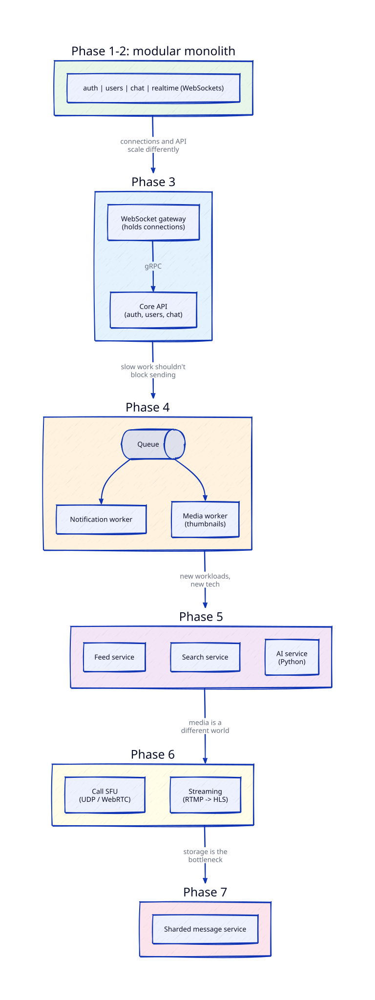

# Monolith → Microservices: When and Why

## The problem

Microservices are not an upgrade, they're a trade. You get independent scaling, deploys
and failure isolation. You pay with network calls instead of function calls, distributed
debugging, harder transactions, and many more moving parts. Splitting too early means
paying the cost without getting the benefit.

## Our rule: split a module out only when one of these is true

1. **It scales differently** — it needs 10× more instances than the rest, or a different resource (memory, UDP, GPU).
2. **It fails differently** — when it crashes or gets slow, it shouldn't take chat down with it.
3. **It deploys differently** — it changes much more often, or needs to restart less often.
4. **It needs a different tech** — e.g. Python for AI work, a media server for calls.

And we prove it with a load test or failure test first, then write an ADR.

## Starting point: modular monolith (Phase 1)

Frontend and backend are always separate apps. Inside the backend, modules have hard
boundaries: each owns its own tables, and others call it only through a Go interface,
never its database tables directly. Extracting one later = replace the interface
implementation with a network client.

## The planned split timeline

| Phase | What splits out | Which rule | Why it's the right moment |
|---|---|---|---|
| 1–2 | Nothing (modular monolith) | — | One server handles 100 users easily; splitting would only add cost |
| **3** | **WebSocket gateway** | 1, 3 | Holding 10k open connections is a different job from answering REST calls. Deploying the API shouldn't drop every user's connection |
| **4** | **Notification + media workers** | 2, 1 | Slow work (push, thumbnails) moves behind a queue so it can't slow down sending messages |
| **5** | **Feed, search, AI service** | 1, 4 | Feed fan-out is write-heavy; search needs its own engine; AI work fits Python + GPUs better |
| **6** | **Call/SFU + streaming services** | 1, 4 | UDP media traffic, huge bandwidth, completely different scaling |
| **7** | Chat core split by data (sharded message service) | 1 | Storage is now the bottleneck, not code organisation |

So: **microservices start in Phase 3, one service at a time**, each with a measured reason.
By Phase 7 we'll have ~8 services, and you'll have felt both sides of the trade.

## What we'll learn at each split

- Service-to-service communication: REST vs gRPC vs messaging
- Service discovery, timeouts, retries, circuit breakers
- Distributed tracing (OpenTelemetry + Jaeger) — following one message across services
- Data ownership: each service owns its data; no shared database
- Consistency across services: outbox pattern, sagas
