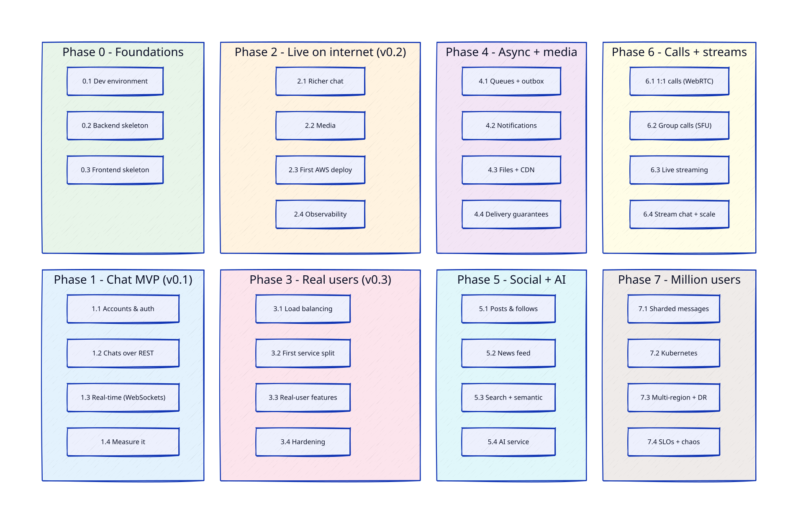

# Phases & Parts — Progress Tracker

Every phase is split into 3–4 parts. Each part goes through the full process:

1. **Brainstorm** → `design.md` (the spec, approved by you)
2. **Plan** → `plan.md` (step-by-step build plan — can be skipped for small parts)
3. **Build** — tests first, you read every line
4. **Measure / break** → numbers, failures
5. **Write up** → `learnings.md`

Each part lives in `phases/phase-N/N.M-<name>/` with its own `diagrams/`.

Status: ⬜ not started · 🟦 design · 🟨 building · ✅ done

## Phase 0 — Foundations · [overview](phase-0/README.md)

| Part | Build | Learn | Status |
|---|---|---|---|
| 0.1 Dev environment | Monorepo skeleton, docker compose + Postgres, Go health endpoints, React status page, Makefile, Dockerfiles | Containers, multi-stage builds, reverse proxy vs CORS, health checks | ✅ [design](phase-0/0.1-dev-environment/design.md) · [learnings](phase-0/0.1-dev-environment/learnings.md) |
| 0.2 Backend skeleton | Go layout, config, structured logging, DB pool, migrations, sqlc, integration-test setup | Go project structure, connection pooling, migrations, testing against a real DB | 🟦 [design](phase-0/0.2-backend-skeleton/design.md) |
| 0.3 Frontend skeleton | Routing, API client, TanStack Query, Tailwind, app layout | Single-page app ↔ API, server state vs UI state | ⬜ |

## Phase 1 — Chat MVP (v0.1)

| Part | Build | Learn | Status |
|---|---|---|---|
| 1.1 Accounts & auth | Signup, login, logout, refresh tokens, profile, auth pages | Password hashing, JWT vs sessions, cookies, XSS/CSRF | ⬜ |
| 1.2 Chats over REST | 1:1 + group chats, members/admins, send messages, history, chat list | Data modelling, indexes, cursor pagination, N+1 queries, estimating load | ⬜ |
| 1.3 Real-time | WebSocket hub, live messages/edits/deletes, unread counts, reconnect + catch-up | WebSocket protocol, goroutine per connection, heartbeats, ordering, idempotency | ⬜ |
| 1.4 Measure it | k6 test with 100 users, pprof, fix the first bottleneck | Latency percentiles, profiling, flame graphs | ⬜ |

## Phase 2 — Live on the internet (v0.2)

| Part | Build | Learn | Status |
|---|---|---|---|
| 2.1 Richer chat | Typing, read receipts, reactions, replies, browser notifications, dark mode | Temporary vs stored events, write amplification | ⬜ |
| 2.2 Media | Profile pictures via MinIO / S3 presigned uploads | Object storage, presigned URLs, why files don't go in the DB | ⬜ |
| 2.3 First AWS deploy | Guard-rails, IAM, VPC, EC2, Terraform, Caddy HTTPS, `make deploy` | Networking basics, DNS, TLS, infrastructure-as-code | ⬜ |
| 2.4 Observability | Prometheus + Grafana + Loki, k6 against AWS, find the breaking point | RED/USE metrics, bottleneck hunting, capacity limits | ⬜ |

## Phase 3 — Ready for real users (v0.3)

| Part | Build | Learn | Status |
|---|---|---|---|
| 3.1 Load balancing | 3 backends behind Nginx/HAProxy, the WebSocket problem → Redis pub/sub, short AWS ALB lab | L4 vs L7, balancing algorithms, sticky sessions, health checks | ⬜ |
| 3.2 First service split | WebSocket gateway service, gRPC, presence/last seen, multi-tab sync, log out everywhere | Service boundaries, gRPC, temporary state in Redis | ⬜ |
| 3.3 Real-user features | Email verify + password reset, invite links, message search, block/report, image messages | Sending email, Postgres full-text search, abuse prevention | ⬜ |
| 3.4 Hardening | Rate limiting, read replica, backups + tested restore, zero-downtime deploys, chaos test | Rate-limit algorithms, replication lag, RPO/RTO | ⬜ |

## Phases 4–7 — detailed when we get there

| Phase | Parts |
|---|---|
| 4 — Async + media | 4.1 Queues + outbox pattern · 4.2 Notifications + offline delivery · 4.3 Files/voice notes + CDN · 4.4 Delivery guarantees |
| 5 — Social + AI | 5.1 Posts & follows · 5.2 News feed (fan-out) · 5.3 Search + semantic search · 5.4 AI service (Python) |
| 6 — Calls + streams | 6.1 1:1 calls (WebRTC) · 6.2 Group calls (Pion SFU) · 6.3 Live streaming (RTMP → HLS) · 6.4 Stream chat + scaling |
| 7 — Million users | 7.1 Sharded message storage · 7.2 Kubernetes + autoscaling · 7.3 Multi-region + DR · 7.4 SLOs + chaos testing |
